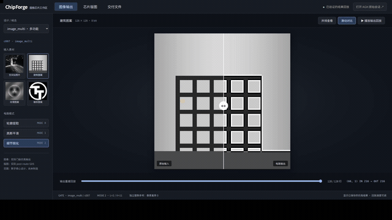
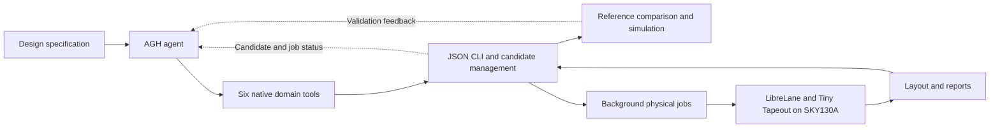

# ChipForge

English | [简体中文](README.zh-CN.md)

An agent-assisted digital chip design workflow, from image-processing requirements and RTL through simulation, validation and physical design.

[Project Overview](#project-overview) · [Demo Video](#demo-video) · [Architecture](#architecture) · [Integration Standards](#integration-standards)

## Project Overview

Designing hardware requires more than producing Verilog: the implementation must satisfy a fixed interface, match a reference model and proceed through a physical-design toolchain. ChipForge packages these steps into a workflow an AGH agent can operate and inspect.

Three designs are included: a fast Sobel core, a compact Sobel core, and a multi-function image-processing core supporting Sobel, Gaussian blur and sharpening. The repository provides their specifications and RTL, an integer reference model, verification and physical-design configuration, and a project-specific AGH plugin.

The agent runtime and external EDA tools are installed separately. The project integrates their capabilities with its own design and verification workflow.

### Core capabilities and highlights

- **Long-horizon coding with engineering feedback.** AGH can read a fixed specification, submit RTL, inspect real verification results, revise the design and follow physical implementation within the same workflow. Image operators provide concrete tasks for this coding and tool-use loop.
- **Traceable candidates and bounded execution.** Each RTL revision is an immutable candidate with an ID, source hash and optional parent. The executor records results and enforces project budgets for RTL candidates and physical jobs.
- **Frozen acceptance criteria and observable jobs.** Specifications, reference tests and constraints are checked against a SHA-256 manifest. Physical implementation runs in background jobs that can be queried; the executor also provides cancellation and recovery actions. Flow completion and final acceptance are tracked separately.

## Demo Video

[](docs/demo/chip-design.mp4)

[Watch the complete video](docs/demo/chip-design.mp4) · [Demo page](docs/demo.html) · [Layout image](docs/demo/layout.jpg)

The demo follows the progression from the design task to verification and layout.

## Architecture



### Core modules

| Module | Implementation | Responsibility |
| --- | --- | --- |
| AGH adapter | [plugins/chipforge-tools](plugins/chipforge-tools) | Register six native tools with JSON schemas and bridge calls to Python. |
| Design executor | [app/cli.py](app/cli.py) | Manage runs, immutable candidates, budgets, validation results and job state. |
| Verification | [verification](verification) | Compare RTL and mapped netlists with an independent integer reference and exercise the streaming protocol. |
| Physical worker | [scripts/harden_worker.py](scripts/harden_worker.py) | Run the LibreLane/Tiny Tapeout flow in a background process and record artifacts. |
| Delivery checks | [scripts/signoff_auditor.py](scripts/signoff_auditor.py) | Inspect generated verification, timing and physical evidence for final acceptance. |
| Design contracts | [specs](specs), [designs](designs), [constraints](constraints) | Keep the arithmetic, interface, RTL and clock/I/O conditions connected. |

### Included designs

| Design | Source | Top module |
| --- | --- | --- |
| Fast Sobel | [designs/sobel_fast](designs/sobel_fast) | `tt_um_cf_sobel_fast` |
| Compact Sobel | [designs/sobel_compact](designs/sobel_compact) | `tt_um_cf_sobel_compact` |
| Multi-function image core | [designs/image_multi](designs/image_multi) | `tt_um_cf_image_multi` |

The reference model is [verification/oracle.py](verification/oracle.py). Physical flow constraints are in [constraints/image_chip.sdc](constraints/image_chip.sdc); the flow uses LibreLane 3.0.14 and SKY130A (`sky130_fd_sc_hd`). See [design flow](docs/design-flow.md), [simulation](docs/simulation.md) and [physical design](docs/physical-design.md).

## Integration Standards

### Hardware and agent interfaces

The hardware contract is the project's `window9_v1` streaming protocol using the Tiny Tapeout top-level interface. It consumes unsigned 8-bit pixels for a 3×3 window. `ui_in[7:0]` carries input pixels; `uio_in[0]` is `in_valid`, `uio_in[1]` is `start_window` and `uio_in[3:2]` selects mode. `uio_out[4]`, `uio_out[5]` and `uio_out[6]` carry `in_ready`, `out_valid` and `busy`, respectively; `uo_out[7:0]` carries output and `uio_oe` is fixed at `8'hf0`.

Input is captured on a rising edge when `in_valid && in_ready`. After nine accepted pixels, the result appears at the latency defined for that design, with a one-cycle `out_valid` pulse. The fast Sobel and multi-function cores use latency/initiation interval L/II = 2/11 cycles; the compact Sobel uses 21/30 cycles. `rst_n` is an active-low synchronous reset; `ena=0` clears an in-progress transaction. The complete arithmetic, mode, reset and timing definitions are in [IMAGE_CHIP_SPEC.md](docs/IMAGE_CHIP_SPEC.md).

The AGH integration is the native plugin `@chipforge/agh-tools`. Its six tools are registered directly with AGH; this repository does not require a separate MCP server.

| Tool | Required inputs | Purpose |
| --- | --- | --- |
| `chip_get_spec` | `design_id` | Read the frozen design contract. |
| `chip_submit_rtl` | `run_id`, `source` | Save a new RTL candidate; `parent_candidate_id` is optional. |
| `chip_validate_rtl` | `run_id`, `candidate_id` | Compile and validate the candidate; return real tool feedback. |
| `chip_harden` | `run_id`, `candidate_id` | Queue physical implementation after RTL validation passes. |
| `chip_get_job` | `run_id`, `candidate_id` | Query the physical job and its artifact references. |
| `chip_get_run` | `run_id` | Read candidates, results and cumulative project budget. |

Plugin inputs are JSON objects. IDs match `^[a-z0-9_-]{1,80}$`; RTL `source` is limited to 65,536 characters. The bridge sends JSON on standard input to `.venv/bin/python app/cli.py <action>`. CLI responses contain `ok` and either `result` or `error_type`/`error`; the plugin also returns `bridge_exit_code`. The underlying CLI exposes eleven actions, including `new_run`, `cancel_job`, `recover_job` and `update_run_state`; see [app/cli.py](app/cli.py).

### Environment and integration

The full agent/EDA workflow targets Linux x86_64 with Python 3.12 and Docker. It uses Icarus Verilog 12, cocotb 2.0.0, LibreLane 3.0.14 and SKY130A; toolchain preparation is in [scripts/prepare_toolchain.sh](scripts/prepare_toolchain.sh). AGH and Tiny Tapeout dependencies are installed separately; the tested upstream commits and setup commands are listed in [physical design](docs/physical-design.md).

The plugin requires an absolute `CHIPFORGE_ROOT`. The supplied [AGH launcher](scripts/run_agh.py) sets it, uses the `local-dev` profile and loads the configured model selection. Credentials are configured through AGH and are not included in this repository. After preparing the external dependencies and configuring the model, `python scripts/run_agh.py --smoke` performs an optional read-only model/plugin probe.

### Verify the reference model

```bash
python3.12 -m venv .venv
source .venv/bin/activate
pip install Pillow==11.3.0
python -m unittest verification.test_oracle
python examples/image_reference.py
```

### Simulate RTL

```bash
docker build -f scripts/Dockerfile.sim -t chipforge-sim:20261003 .
mkdir -p outputs/sobel-fast/rtl
cp designs/sobel_fast/project.v outputs/sobel-fast/rtl/project.v
cp designs/sobel_fast/spec.json outputs/sobel-fast/spec.json
docker run --rm -e PYTHONPATH=/workspace -v "$PWD:/workspace:ro" -v "$PWD/outputs/sobel-fast:/candidate" chipforge-sim:20261003 python /workspace/verification/run_sim.py
```

For the complete AGH and physical-design setup, follow [design flow](docs/design-flow.md) and [physical design](docs/physical-design.md), install AGH and the Tiny Tapeout dependencies separately, and configure the paths described there. Dependency notices: [DEPENDENCY_LICENSES.md](DEPENDENCY_LICENSES.md); project license: [LICENSE](LICENSE).
