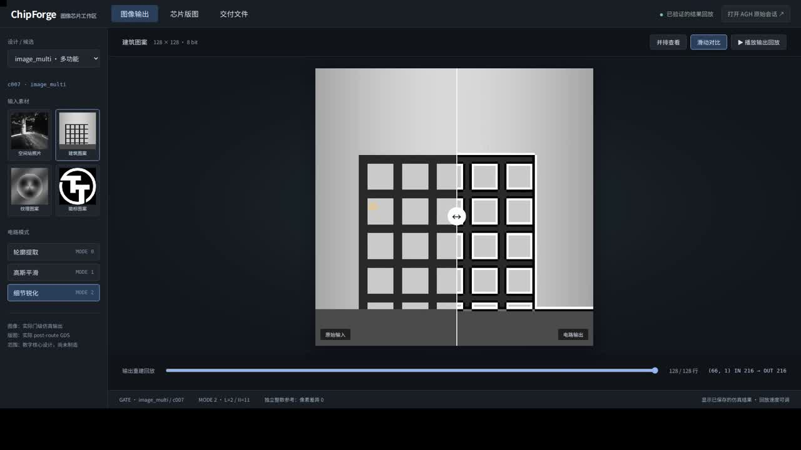
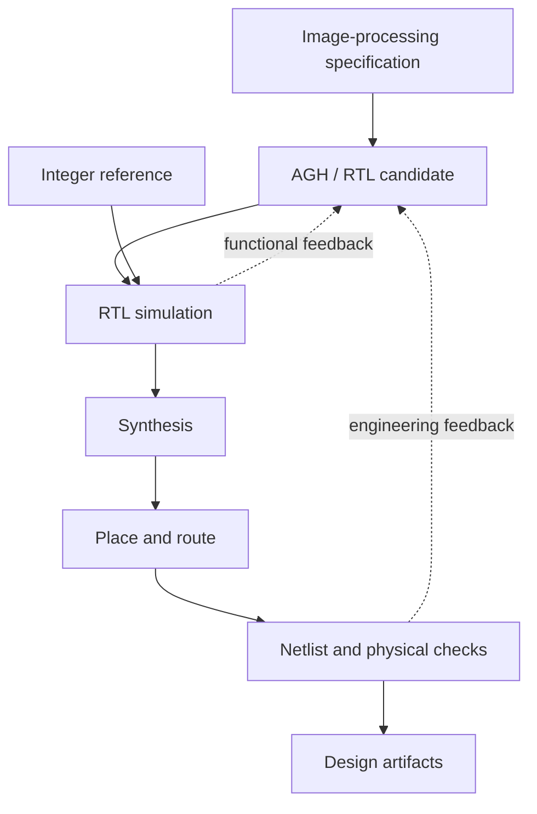

<div align="center">

# ChipForge

### 从图像处理规格到 RTL、验证与版图
### From image-processing specifications to RTL, verification and layout

[演示视频 / Demo](docs/demo/chip-design.mp4) · [功能仿真 / Simulation](docs/simulation.md) · [物理实现 / Physical design](docs/physical-design.md)

</div>

[](docs/demo/chip-design.mp4)

## 项目概览 / Overview

ChipForge 将芯片设计任务组织成一个可以持续推进的工程闭环。AGH 读取图像处理规格，提交 RTL 候选，调用仿真和物理实现工具，依据结果修复设计，再继续完成验证与交付。项目把长程设计中的代码、专业工具、候选管理和结果反馈连接在一起。

ChipForge turns an image-processing requirement into a sequence of executable design steps. AGH reads the specification, proposes RTL, invokes verification and implementation tools, and revises the candidate using engineering feedback. The project connects agent-driven coding with the concrete artifacts of a digital hardware flow.

## 为什么需要这条闭环 / Motivation

电路设计的难点贯穿多个环节：算法需要转成定点与时序逻辑，流式接口需要处理有效输入、复位和输出时刻，仿真需要覆盖边界行为，物理实现还要考虑时钟与 I/O 条件。一次代码生成之后，仍然需要读懂工具反馈并继续修改。

The work therefore extends beyond RTL generation. A candidate must obey its arithmetic and streaming interface, pass functional checks, enter synthesis and place-and-route, and remain connected to the reports used for subsequent decisions. Long-running implementation jobs also need a status and recovery interface.

## 三份设计与三类图像处理 / Designs and operations

| 设计 / Design | 图像功能 / Operation | RTL | 顶层 / Top module |
|---|---|---|---|
| Sobel fast | 边缘提取 / edge detection | [project.v](designs/sobel_fast/project.v) | `tt_um_cf_sobel_fast` |
| Sobel compact | 资源复用的边缘提取 / resource-reuse Sobel | [project.v](designs/sobel_compact/project.v) | `tt_um_cf_sobel_compact` |
| Image multi | 边缘、Gaussian 平滑、锐化 / edge, blur, sharpen | [project.v](designs/image_multi/project.v) | `tt_um_cf_image_multi` |

三份设计都附带规格。图像处理使用 8 位无符号像素和 3×3 窗口；多模式核心通过模式选择执行 Sobel、Gaussian 平滑或锐化。整数参考保存在 `verification/oracle.py`。

Each design has an accompanying specification. The pixel datapath uses unsigned 8-bit samples and a 3×3 window. The multi-operation core selects edge detection, Gaussian blur or sharpening. The independent integer reference is implemented in `verification/oracle.py`.

### 接口也是设计的一部分 / The interface is part of the design

规格定义九个像素的接收顺序、有效输入间隔、复位、开始新窗口、忙状态及输出有效脉冲。`ui_in`、`uo_out` 和双向端口用于表达数据与控制，时钟和 I/O 条件位于 `constraints/image_chip.sdc`。

The specification defines sample order, valid gaps, reset behavior, window restart, busy state and output-valid timing. These details are exercised alongside arithmetic behavior, so the same reference operation is connected to a complete streaming interface.

## 工程实现范围 / Engineering scope

项目包含以下相互连接的实现：

1. 三份可综合 RTL 与各自的功能规格。
2. 图像整数参考、窗口生成和边界处理。
3. RTL 仿真、网表验证与工程检查入口。
4. 设计任务、候选与状态管理。
5. 长任务的启动、查询、取消和恢复。
6. AGH 原生领域插件与模型接口适配。
7. Tiny Tapeout、LibreLane 和 SKY130 的物理实现接入。

These components form one workflow: the agent-facing tools manage design actions, the executor manages candidates and jobs, and professional tools produce the verification and implementation results. AGH supplies the agent runtime and plugin infrastructure; ChipForge supplies the design-specific tools, executor, references and integration.

### 从规格到工程反馈 / Specification to feedback



执行器提供十一类操作，覆盖一次设计从准备到完成的过程。

The executor exposes eleven actions across the design lifecycle:

| 阶段 / Stage | 操作 / Actions |
|---|---|
| 准备 / Prepare | `doctor`, `get_spec`, `new_run` |
| RTL | `submit_rtl`, `validate` |
| 物理任务 / Implementation jobs | `harden`, `job_status`, `cancel_job`, `recover_job` |
| 设计状态 / Design state | `status`, `update_run_state` |

## 路线一：运行图像参考 / Route A: run the image reference

先用 Python 和 Pillow 检查三类图像操作。这个入口会从输入图像重新生成边缘、平滑和锐化结果。

Start with Python and Pillow. This route regenerates the three image-processing reference outputs from the included image.

```bash
python3.12 -m venv .venv
source .venv/bin/activate
pip install Pillow==11.3.0
python -m unittest verification.test_oracle
python examples/image_reference.py
```

输出位于 `outputs/`，包含 `sobel.png`、`gaussian.png` 和 `sharpen.png`。参考测试覆盖阈值、像素极值、饱和以及边界窗口。

The generated images are written to `outputs/`. The reference tests exercise thresholds, unsigned extremes, saturation and replicated image borders.

## 路线二：验证 RTL / Route B: simulate the RTL

RTL 仿真使用 Linux、Docker、Icarus Verilog 和 cocotb。建立仿真镜像并准备一个独立候选目录：

```bash
docker build -f scripts/Dockerfile.sim -t chipforge-sim:20261003 .
mkdir -p outputs/sobel-fast/rtl
cp designs/sobel_fast/project.v outputs/sobel-fast/rtl/project.v
cp designs/sobel_fast/spec.json outputs/sobel-fast/spec.json
```

运行验证：

```bash
docker run --rm \
  -e PYTHONPATH=/workspace \
  -v "$PWD:/workspace:ro" \
  -v "$PWD/outputs/sobel-fast:/candidate" \
  chipforge-sim:20261003 python /workspace/verification/run_sim.py
```

结果写入候选目录的 `verification/`。更换 `designs/` 下的 RTL 和规格，可以运行另外两份设计。

The same setup can be reused for the other two design directories. Detailed steps are in [功能仿真 / simulation](docs/simulation.md).

## 路线三：接入智能体与 EDA / Route C: agent and implementation flow

专业环境使用 Python 3.12、Node.js 24、pnpm、Docker、LibreLane 3.0.14，以及 SKY130A 的 `sky130_fd_sc_hd` 标准单元库。

The full flow connects a separately installed AGH workspace and Tiny Tapeout dependencies to the digital implementation toolchain. Prepare the environment and local connections:

```bash
bash scripts/prepare_toolchain.sh
source scripts/env.sh
export AGH_SOURCE_DIR=/opt/agnes-harness
export CHIPFORGE_TT_TEMPLATE_DIR=/opt/ttsky-template
export CHIPFORGE_TT_TOOLS_DIR=/opt/tt-support-tools
(cd "$AGH_SOURCE_DIR" && pnpm install --frozen-lockfile && pnpm --filter @agnes/cli build:local)
python scripts/connect_agh.py
```

外部依赖版本与 PDK 准备见[物理实现指南](docs/physical-design.md)。`connect_agh.py --check` 可只核对路径，生成的依赖连接位于已忽略目录。

在 AGH 配置模型账户并启用 `plugins/chipforge-tools/`。模型选择位于 `model.selection.json`；接口适配补丁保存在 `patches/`。配置 PDK 后，执行器的 `harden` 操作提交物理实现任务，状态和结果通过后续工具调用返回。

Configure the model account in AGH and enable the ChipForge tools plugin. The executor submits implementation through `harden`, while the job APIs expose progress, cancellation and recovery. Tool feedback returns to the design session for the next revision.

一个新设计任务从下面的入口开始：

```bash
echo '{"design_id":"sobel_fast","request":"实现图像边缘提取核心"}' \
  | .venv/bin/python app/cli.py new_run
```

工具链、工艺库、任务和输出路径的完整说明见[物理实现指南](docs/physical-design.md)。

## 源码阅读 / Source tour

```text
designs/                RTL examples and their specifications
specs/                  arithmetic and interface requirements
constraints/            clock and I/O settings
verification/           integer reference, simulation and checks
app/                    task and candidate executor
plugins/                AGH domain tools
scripts/                toolchain and implementation integration
patches/                model-interface adaptation
docs/physical-design.md  external AGH, Tiny Tapeout and PDK setup
```

建议先从图像参考和一份 RTL 开始，再阅读工具插件与执行器，最后进入物理实现脚本。

For the end-to-end module relationship, see [设计流程 / design flow](docs/design-flow.md).

---


[第三方组件 / Dependencies](DEPENDENCY_LICENSES.md) · [项目许可证 / License](LICENSE)
