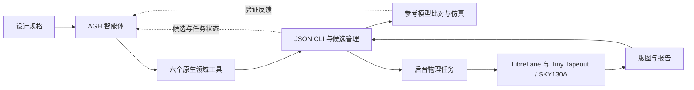

# ChipForge 智能芯片设计

[English](README.md) | 简体中文

从图像处理需求出发，通过智能体组织 RTL 设计、仿真验证与物理设计。

[项目介绍](#项目介绍) · [演示视频](#演示视频) · [技术架构](#技术架构) · [集成标准](#集成标准)

## 项目介绍

芯片设计不仅要生成 Verilog，还需要满足固定接口、与参考模型逐项核对，并经过物理设计工具链。本项目把这些环节组织成 AGH 智能体可调用、可查看反馈的流程。

仓库提供三类设计：高速 Sobel 核、紧凑 Sobel 核，以及支持 Sobel、高斯模糊和锐化的多功能图像处理核；还包含各自规格和 RTL、整数参考模型、验证配置、物理设计配置与项目专用 AGH 插件。

智能体运行时和 EDA 工具需要单独安装；项目将这些能力与自身的设计和验证流程集成。

### 核心功能与创新亮点

- **带工程反馈的长程 Coding。** AGH 可以在同一流程中读取固定规格、提交 RTL、检查真实验证结果、修改设计，并继续跟进物理实现。图像算子为这条编码与工具调用闭环提供具体任务。
- **可追溯的候选与有界执行。** 每次 RTL 修改保存为独立且不可变的候选，带有编号、源码摘要和可选的父版本。执行器记录工具结果，并限制项目累计的候选数量和物理任务数量。
- **冻结验收条件与可观测后台任务。** 规格、参考测试和约束通过 SHA-256 清单校验。物理实现作为后台作业运行并可查询；执行器还支持取消和恢复任务。流程完成与最终验收分别记录。

## 演示视频

[](docs/demo/chip-design.mp4)

[观看完整视频](docs/demo/chip-design.mp4) · [演示页面](docs/demo.html) · [版图图片](docs/demo/layout.jpg)

视频展示了设计任务、验证和版图生成的过程。

## 技术架构



### 核心模块

| 模块 | 实现位置 | 职责 |
| --- | --- | --- |
| AGH 适配层 | [plugins/chipforge-tools](plugins/chipforge-tools) | 使用 JSON Schema 注册六个原生工具，将调用桥接到 Python。 |
| 设计执行器 | [app/cli.py](app/cli.py) | 管理运行、不可变候选、预算、验证结果和任务状态。 |
| 验证模块 | [verification](verification) | 以独立整数模型比对 RTL 和映射网表，并检查流式接口协议。 |
| 物理任务执行器 | [scripts/harden_worker.py](scripts/harden_worker.py) | 在后台进程中运行 LibreLane/Tiny Tapeout 流程并记录产物。 |
| 交付检查 | [scripts/signoff_auditor.py](scripts/signoff_auditor.py) | 检查新生成的验证、时序和物理证据，支撑最终验收。 |
| 设计契约 | [specs](specs)、[designs](designs)、[constraints](constraints) | 关联计算规则、接口、RTL 以及时钟和 I/O 条件。 |

### 随附设计

| 设计 | 源码 | 顶层模块 |
| --- | --- | --- |
| 高速 Sobel | [designs/sobel_fast](designs/sobel_fast) | `tt_um_cf_sobel_fast` |
| 紧凑 Sobel | [designs/sobel_compact](designs/sobel_compact) | `tt_um_cf_sobel_compact` |
| 多功能图像处理核 | [designs/image_multi](designs/image_multi) | `tt_um_cf_image_multi` |

参考模型见 [verification/oracle.py](verification/oracle.py)，物理设计约束见 [constraints/image_chip.sdc](constraints/image_chip.sdc)。流程使用 LibreLane 3.0.14 和 SKY130A（`sky130_fd_sc_hd`）。详见 [设计流程](docs/design-flow.md)、[仿真说明](docs/simulation.md) 和 [物理设计](docs/physical-design.md)。

## 集成标准

### 硬件接口与智能体工具

硬件采用项目定义的 `window9_v1` 流式协议和 Tiny Tapeout 顶层接口，接收 3×3 窗口的无符号 8 位像素。`ui_in[7:0]` 输入像素，`uio_in[0]` 为 `in_valid`，`uio_in[1]` 为 `start_window`，`uio_in[3:2]` 选择模式；`uio_out[4]`、`uio_out[5]`、`uio_out[6]` 分别表示 `in_ready`、`out_valid`、`busy`，`uo_out[7:0]` 输出结果，`uio_oe` 固定为 `8'hf0`。

在时钟上升沿且 `in_valid && in_ready` 时采样。接收九个像素后，结果在该设计规定的延迟处产生，`out_valid` 保持一个周期。高速 Sobel 和多功能核的延迟/启动间隔 L/II 为 2/11 个周期，紧凑 Sobel 为 21/30 个周期。`rst_n` 为低有效同步复位，`ena=0` 会清空进行中的事务。完整的计算规则、模式、复位和周期定义见 [IMAGE_CHIP_SPEC.md](docs/IMAGE_CHIP_SPEC.md)。

AGH 集成采用原生插件 `@chipforge/agh-tools`，六个工具直接注册到 AGH，无需额外启动 MCP 服务器。

| 工具 | 必需输入 | 用途 |
| --- | --- | --- |
| `chip_get_spec` | `design_id` | 读取冻结的设计规格。 |
| `chip_submit_rtl` | `run_id`、`source` | 保存新 RTL 候选；可选 `parent_candidate_id` 关联父版本。 |
| `chip_validate_rtl` | `run_id`、`candidate_id` | 编译和验证候选，返回真实工具反馈。 |
| `chip_harden` | `run_id`、`candidate_id` | 在 RTL 验证通过后提交物理实现。 |
| `chip_get_job` | `run_id`、`candidate_id` | 查询物理任务及其产物位置。 |
| `chip_get_run` | `run_id` | 查看候选、结果和累计项目预算。 |

插件参数为 JSON 对象，编号须匹配 `^[a-z0-9_-]{1,80}$`，RTL `source` 最多为 65,536 个字符。桥接层通过标准输入向 `.venv/bin/python app/cli.py <action>` 发送 JSON。CLI 响应包含 `ok`，以及成功时的 `result` 或失败时的 `error_type`/`error`；插件另附 `bridge_exit_code`。底层 CLI 共提供十一类操作，其中包括 `new_run`、`cancel_job`、`recover_job` 和 `update_run_state`，详见 [app/cli.py](app/cli.py)。

### 环境与集成方式

完整智能体与 EDA 流程面向 Linux x86_64、Python 3.12 和 Docker，使用 Icarus Verilog 12、cocotb 2.0.0、LibreLane 3.0.14 和 SKY130A。工具准备入口为 [scripts/prepare_toolchain.sh](scripts/prepare_toolchain.sh)。AGH 与 Tiny Tapeout 依赖需单独安装；已适配的上游提交和配置命令见 [物理设计](docs/physical-design.md)。

插件要求 `CHIPFORGE_ROOT` 为绝对路径。随附的 [AGH 启动器](scripts/run_agh.py) 会设置该变量，使用 `local-dev` 配置并读取模型选择。模型凭据通过 AGH 配置，不包含在仓库内。完成外部依赖准备和模型配置后，可用 `python scripts/run_agh.py --smoke` 进行可选的只读模型与插件连通检查。

### 验证参考模型

```bash
python3.12 -m venv .venv
source .venv/bin/activate
pip install Pillow==11.3.0
python -m unittest verification.test_oracle
python examples/image_reference.py
```

### 仿真 RTL

```bash
docker build -f scripts/Dockerfile.sim -t chipforge-sim:20261003 .
mkdir -p outputs/sobel-fast/rtl
cp designs/sobel_fast/project.v outputs/sobel-fast/rtl/project.v
cp designs/sobel_fast/spec.json outputs/sobel-fast/spec.json
docker run --rm -e PYTHONPATH=/workspace -v "$PWD:/workspace:ro" -v "$PWD/outputs/sobel-fast:/candidate" chipforge-sim:20261003 python /workspace/verification/run_sim.py
```

完整 AGH 与物理设计环境按 [设计流程](docs/design-flow.md) 和 [物理设计](docs/physical-design.md) 配置，AGH 和 Tiny Tapeout 依赖需单独准备。第三方许可见 [DEPENDENCY_LICENSES.md](DEPENDENCY_LICENSES.md)，项目许可见 [LICENSE](LICENSE)。
