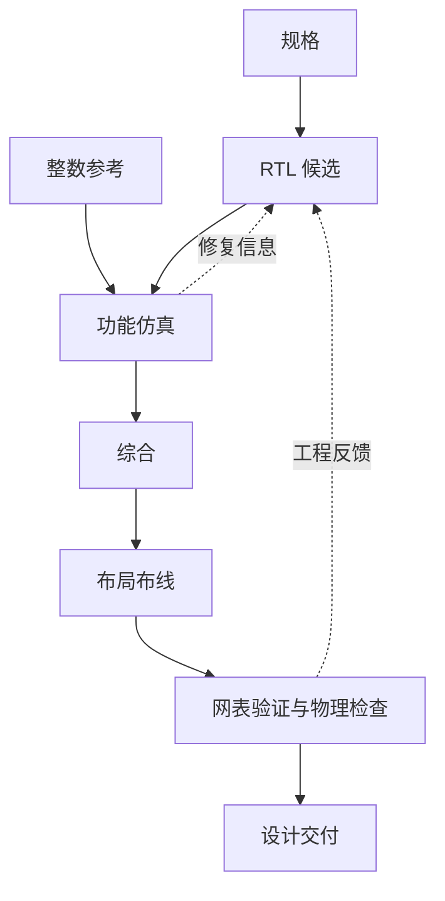

# 设计执行流程

## 规格和产物

每份设计由 `specs/` 中的功能规格与 `constraints/image_chip.sdc` 中的时钟、I/O 条件约束。最终 RTL 示例在 `designs/`，整数参考在 `verification/oracle.py`。

## 自动设计怎样继续推进

AGH 通过 `plugins/chipforge-tools/` 调用 `app/cli.py`。执行器管理新任务与候选，专业工具负责仿真、综合和物理实现。工具结果返回同一设计会话，作为后续修改的输入。

## 两条阅读路线

- 图像功能：`examples/image_reference.py` → `verification/oracle.py` → `designs/`。
- 工程闭环：`plugins/` → `app/cli.py` → `verification/` 与 `scripts/`。

Icarus/cocotb 检查 RTL；LibreLane、Tiny Tapeout 与 SKY130 提供数字物理实现流程。
